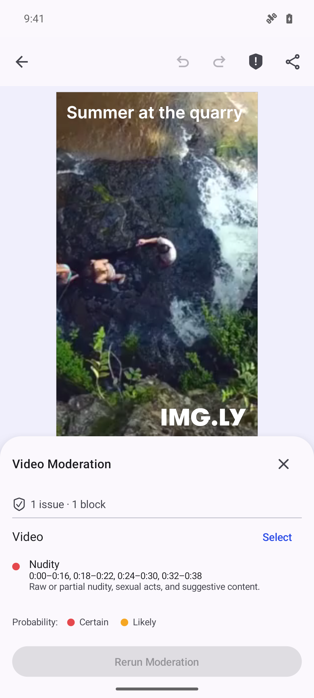

## Video Moderation Starter Kit

  

The starter kit is built on top of the Creative Editor SDK.
It shows how to add automatic moderation to a video editor: every video clip, image and text on the timeline can be checked against a moderation service.

- Clips and images are flagged for Nudity, Weapons, Recreational Drugs, Medical, Alcohol, Offensive Symbols, and Gore.
- Text and captions are flagged for Toxic, Insulting, Discriminatory, Violent, and Sexual Language, and for Self-Harm.
- The bundled IMG.LY gateway provider scores a frame every two seconds. Only the frames inside the part of a clip that plays count, so content you trim away does not flag the clip.

A **Video Moderation** button in the navigation bar checks every clip, image and text in the scene and opens a bottom sheet listing what was flagged, grouped by block. For a clip, each category shows the flagged times, for example `0:04–0:10`. **Select** selects the block and moves the playhead to the first flagged moment of a clip, or to the start of an image or a text. The same result is used when exporting: if a block is flagged, or the video changed since the last check, a dialog asks the user to confirm before the export continues.

Each source file is sent once. A trim, a split or a move changes only which frames count, so checking again after such an edit does not call the service again.

The moderation backend sits behind a single `ContentModerationProvider` interface. The bundled `GatewayModerationProvider` calls the `imgly/detection` model on the IMG.LY gateway with the clip's `video_url`, an image URL or the text, and adds no third-party dependencies (it uses `HttpURLConnection` and `org.json`). Clips from the gallery or the camera are uploaded to the gateway first, and local images are rendered and uploaded. To use your own moderation service, implement `ContentModerationProvider` and pass it to `VideoModerationConfigurationBuilder` in `EditorActivity` — nothing else needs to change.

### Gateway API Key

Create a key in the [IMG.LY dashboard](https://img.ly/dashboard) and set `GATEWAY_API_KEY` in `GatewayModerationProvider.kt`. The key must have access to `imgly/detection` and a credit balance. A video costs credits for each sampled frame, so a longer clip costs more than a short one.

### Repository Structure

- Repository is a fully functional Android project with `:starter-kit` and `:app` modules.
- `:starter-kit` library module encapsulates the implementation of the starter kit. Starting point of the starter kit implementation is at `VideoModerationConfigurationBuilder.kt`.
- `:app` application module launches `EditorActivity.kt` that displays the `Editor` composable using `VideoModerationConfigurationBuilder`.

### Building The Repository

1. Clone the repository.
2. [Create and launch](https://developer.android.com/studio/run/managing-avds) a new android emulator or use an existing one.
3. Open the local repository via `Android Studio` and click the `Run` button or go to the local repository via terminal and call `./gradlew installDebug`.

### Useful links

- [CESDK Android Documentation](https://img.ly/docs/cesdk/android)
- [CESDK Android Source Code](https://github.com/imgly/cesdk-android)
- [CESDK Android Examples and Play Store App Code](https://github.com/imgly/cesdk-android-examples)
